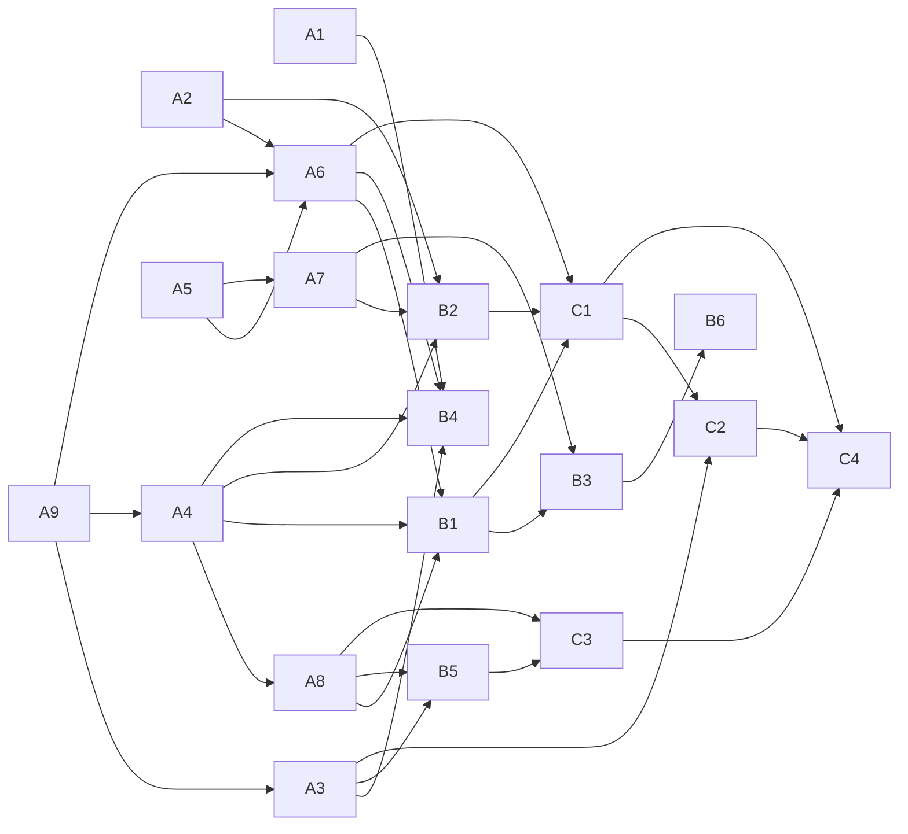

# Instaflow — M1 work plan: core authoring

> Status: **draft for review** (2026-10-25). Inputs: [PLAN.md](PLAN.md) §2–3 (M1 row and SF-Δ list),
> [PHASE0-FINDINGS.md](PHASE0-FINDINGS.md), [DECISIONS.md](DECISIONS.md) (D1–D15). Nothing here is built yet.

## Goal

A person opens Instaflow in Chrome, makes a multi-page design or an infinite-canvas board with shapes, images,
vectors and rich text, edits it in two tabs at once, names milestones, starts a new document from one or from a
template, and exports PNG, PDF, SVG or `.iflow`. Everything is saved continuously in browser storage, optionally
mirrored to a real folder. No timeline, no agents yet (M2, M3).

## Exit criteria

- **Scenarios green in CI (Playwright, real Chromium):** create → edit → milestone → new-from-milestone; template
  with slots; two-tab co-editing with concurrent edits and per-actor undo; tab crash mid-edit loses no acknowledged
  edit; folder mirror on and off; export each format and re-import `.iflow`; unsupported-browser screen; read-only.
- **Budgets enforced in CI** (IF-15): boot JS, editor initial JS, render and authoring Wasm, Loro Wasm, export
  extras; canvas pan/zoom/drag p95 and time to sharp from a perf-lab job (SwiftShader for regressions, owner GPU for
  absolute numbers until a reference iGPU runner exists).
- **Shared contract suites** green: `BlobStore`, `DocumentRepo`, `DocumentCRDT` (N-peer convergence), the S2
  sequencing oracle, render golden images, export parity.
- Every new package and app area has `AGENTS.md`, lifecycles in `docs/LIFECYCLES.md`, `SF-*` / `IF-*` error codes
  with fixes, and unit tests for every exported function (repo rules 1–10).
- Spike folders deleted (`apps/instaflow/spikes/`), their lessons living in tests and docs.

## How we build it

- **Framework first, per stage.** Each stage starts with the StaticFlux changes it needs, then the app features on
  top. Framework packages never import the app.
- **One work package = one owner (person or agent), one package or app area, its own tests and `AGENTS.md`.**
  Packages talk through ports with contract suites, so parallel work meets at tested seams.
- **Port spike code, never copy it.** Spikes proved approaches; production code is rewritten to the repo rules
  (Result errors, AbortSignal, scopes, typed tokens) with the spike's measurements turned into tests.
- **Every stage ends with a demo** that runs in Chrome and a short review before the next stage starts.

## Stages and work packages

Sizes are relative (S ≈ days, M ≈ 1–2 weeks, L ≈ 2–3 weeks for one owner).

### M1a — Foundations

| WP | Scope | SF-Δ / IF | From spike | Depends on | Size |
|---|---|---|---|---|---|
| **A1** Platform facts and unsupported screen | WebGPU adapter, WebCodecs, OPFS sync handles, FSA, EditContext, Local Font Access, Compression Streams facts; async fact lane; unsupported boot plan; COOP/COEP `credentialless` | Δ26, IF-2.2–2.4, 2.8 | – | – | S |
| **A2** Rust/Wasm build and licenses | One Rust workspace in `pnpm build`; Wasm SIMD on; Wasm budget categories in size reports; license allowlist incl. model-weights registry | Δ32, IF-2.10–2.11 | S1 (SIMD), S9 (licenses) | – | M |
| **A3** Workspace store | `@staticflux/blob`: BlobStore port, chunked hashing, OPFS backend (sync handles for log and large blobs, `createWritable` for small files), head CAS under Web Locks, leader tab, incremental compaction, catalog-driven GC; folder backend as a **batched mirror**; zip bundle; quota and `persist()` | Δ1, Δ2, IF-3.1–3.12 | S6 | – | L |
| **A4** Document engine | `DocumentRepo` (parts, lazy load, head CAS, log + snapshot); `DocumentCRDT` v2; **Loro adapter, one doc per page (D14)**, handle-leak test, one commit per gesture; components with versions/migrations, JSON Schema, canonical part encoding | Δ3–Δ6, IF-4.1–4.14 | S4 | – | L |
| **A5** Worker plumbing | Handle channel; sequenced binary delta stream with gap → resnapshot; brokered peer channels; worker scheduler and long-task detector; lossless input forwarding into a binary ring | Δ17, Δ18 (M1 part), Δ19, Δ22, Δ28 | S2 | – | M |
| **A6** Render module | `RasterBackend` (Vello GPU), 512 px tiles per √2 zoom, lifted layers, WGSL compositor, tile prep in a helper/idle lane, pipeline warm-up with a cached first frame, GPU device-loss recovery, GPU memory budgets | Δ23, Δ24 (headless part), Δ29, IF-7.4–7.5, 7.11 | S1, S7 | A2, A5 | L |
| **A7** Editor ↔ render sequencing | Editor and render **modules** with fixed ports; one-or-two-worker boot setting, **default one (D15)**; draw on arrival; deltas before view frames; binary render projection; spatial index (rbush); the **S2 oracle as a shared test suite**; the main-rAF tick experiment for the split | D15, Δ25, IF-7.1–7.3 | S2 | A5 | M |
| **A8** Stage, attribution, undo | `@staticflux/stage` (local + session layers, composed stage, provenance); actor records into transactions; per-actor undo service, 200 steps, persisted; undo-over-overwrite conflict flag | Δ7 (part), Δ9, Δ10, IF-4.12–4.13 | S4 | A4 | M |
| **A9** Testkit | GPU device fake, golden render snapshots, perceptual diff; contract suites for BlobStore, DocumentRepo, N-peer convergence | Δ31 (M1 part) | S1, S4, S6 | – | M |

**M1a demo:** open a generated 50k-node, 200-page document in under a second; pan, zoom and drag 100 elements on a
10k-element page; kill the tab mid-edit and reopen with nothing lost; two tabs editing the same page converge.

### M1b — Authoring

| WP | Scope | SF-Δ / IF | Depends on | Size |
|---|---|---|---|---|
| **B1** Elements and styles | Frame, group, rect/ellipse/polygon, image, vector paths, booleans (linesweeper, non-destructive), effects; brand-kit tokens and classes; locks | IF-4.6–4.7, 7.9 | A4, A6, A8 | L |
| **B2** Text | Parley in the authoring Wasm; `TextInput` port (EditContext, hidden-textarea for Firefox); rich-text marks with stable anchors; Local Font Access plus uploads; `complex-scripts` loaded lazily; **human IME check (JA/ZH/KO)** before sign-off | Δ27, IF-7.6–7.7 | A2, A4, A7 | L |
| **B3** Tools | Hit testing (rbush → kurbo), select, marquee, transform handles, snapping and guides, nudge; per-tab view state | IF-7.2, 7.8 | A7, B1 | M |
| **B4** Library and lenses | Library document, ingest and hashing, renditions (thumbnails); **Pages** and **Canvas** lenses as per-mode features (no branches on mode) | IF-3.7–3.9, D4 | A3, A4, A6 | M |
| **B5** Versioning | Continuous save indicator; milestones (create, name, pin, open read-only); side-by-side compare; **New document from milestone** with detached baseline; templates with slots | IF-5.1–5.9, 5.11 | A3, A4, A8 | M |
| **B6** Accessibility layer | Virtualized DOM projection of the visible region, selection and focus path; chrome to WCAG 2.2 AA from the start | IF-7.12 | B3 | M |

**M1b demo:** build a five-page flyer set from a template, with brand tokens, rich text in two scripts, booleans
and snapping; take a milestone, branch a new document from it; co-edit it in two tabs with separate undo.

### M1c — In and out

| WP | Scope | SF-Δ / IF | Depends on | Size |
|---|---|---|---|---|
| **C1** Export | Frozen snapshot at export start (IF-5.10, D10: no record); PNG via headless Vello; PDF via krilla (lazy chunk, real text); SVG writer; **decide the SVG parity rule** (tolerant metric or per-feature rasterize list) | Δ24, IF-5.10, 7.10 | A6, B1, B2 | M |
| **C2** Import | `.iflow` export/import (stored parts copied without recompression), file handler via launch queue; SVG import through usvg | Δ33, IF-13.3–13.4 | A3, C1 | M |
| **C3** Modes and identity | Read-only mode (same renderer, editing capabilities not declared); guest identity; gating for modes, locks and brand rules | IF-13.1, IF-14.1–14.4, D3 | A8, B5 | S |
| **C4** Hardening | All M1 scenarios in Playwright; perf-lab job with budgets; size budgets ratcheted; spike folders removed | IF-15, IF-16 | all | M |

**M1c demo:** export the flyer set as PNG, PDF and SVG, send the `.iflow` to a second browser profile and open it
there; open the app in Safari and see the unsupported screen.

## Order of work

| Wave | Work packages in parallel | Starts when |
|---|---|---|
| 1 | A1, A2, A3, A4, A5, A9 | this plan is approved |
| 2 | A6, A7, A8 | A2 + A5 (A6, A7), A4 (A8) are merged |
| — | **M1a demo and review** | wave 2 merged |
| 3 | B1, B2, B4, B5 | M1a review |
| 4 | B3, then B6 | B1 merged |
| — | **M1b demo and review** (incl. IME check) | wave 4 merged |
| 5 | C1, C3, then C2 | M1b review |
| 6 | C4 | all merged |

## Decisions to make during M1

| When | Decision | Input |
|---|---|---|
| A7 | Two workers become the default? (D15) | Main-rAF tick experiment on the owner Mac and a 60/120 Hz display |
| A3 | Folder mirror flush policy (idle delay, max interval) | S6 numbers; feel in the M1a demo |
| B2 | Hidden-textarea adapter on Chrome too? | Human IME check |
| C1 | SVG parity rule | S7 corpus rerun with the chosen metric |
| C4 | Reference iGPU runner for absolute perf budgets | Hardware availability |

## Risks in M1

| Risk | Mitigation |
|---|---|
| Loro handle leaks slow merges over long sessions (S4 saw 48–150 s) | Leak test in A4's contract suite; handle accounting in dev builds |
| Cold first frame ≈ 1 s (S1) | Warm-up in A6; "first sharp frame" added to the perf-lab budgets |
| Tile raster spikes during continuous zoom (S1: 8 of 120 frames) | Helper-lane tile prep; show the scaled previous level |
| Folder mirror falls behind under heavy editing | Mirror is never on the ack path; status shown in the storage panel |
| Wave 1 packages drift apart | Contract suites first in A9; ports reviewed before implementations |
